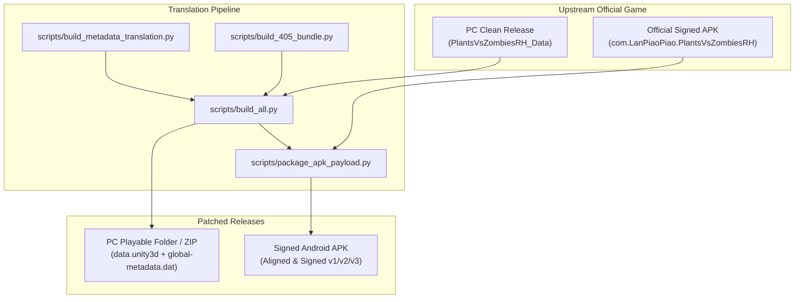

# PvZ Fusion Translation Toolkit — Architecture & Developer Guide

This document describes the technical architecture, repository structure, and build pipeline for the *Plants vs. Zombies: Fusion* translation toolkit (PC & Android), targeting **v4.1**.

> [!IMPORTANT]
> **No hardcoded translations in scripts.** All Chinese→English mappings, display strings, and UI labels MUST be stored in JSON files under `translation-data/`. Build scripts must read those files at runtime. Adding inline translation dictionaries to Python source is a policy violation.

---

## 1. Quick Start & Build Commands

### Prerequisites
- **Python 3.10+** with virtual environment (`.venv/`)
- Python packages: `pip install -r requirements.txt` (includes `UnityPy`, `Pillow`)
- **Java JDK 17+** with `apksigner` and `zipalign` (in PATH or Android SDK `build-tools`) for Android APK signing.

### Build Commands
```powershell
# 1. Build PC Version Only (local testing — default during development)
.\.venv\Scripts\python.exe scripts\build_pc.py

# 2. Build Android APK only (when explicitly needed)
.\.venv\Scripts\python.exe scripts\build_android.py

# 3. Package PC ZIP (release only — not during local testing)
.\.venv\Scripts\python.exe scripts\package_pc_zip.py
```

> [!NOTE]
> During iterative development, only run the PC build. Do not build the Android APK or package ZIP unless preparing an official release for GitHub / Google Drive.

### Outputs
- **PC Executable**: `build/PC_PVZ-Fusion-4.1/PlantsVsZombiesRH.exe` (runnable immediately on Windows).
- **PC Release Artifacts**: `build/pc-41/` (`data.unity3d`, `global-metadata.dat`, build reports).
- **Android Signed APK**: `build/android-41/PvZ-Fusion-4.1-English-Android.apk` (aligned and signed with v1, v2, and v3 schemes).
- **Harmony Fix ZIP**: `build/BepInEx-Harmony-Fix-v4.1.zip` (when applicable).

---

## 2. Repository Structure

All translation data is strictly separated from build scripts:

```text
├── translation-data/
│   ├── Strings/                          # All runtime translation data (JSON only — no hardcoding in scripts)
│   │   ├── translation_strings.json      # Exact UI strings & C# literals
│   │   ├── translation_regexs.json       # Regex substitution rules (1-based group refs)
│   │   ├── odyssey_evolution.json        # Odyssey Evolved / Super Stack Up mode strings
│   │   ├── abyss_buffs.json              # Realm / Abyss modifier strings
│   │   ├── travel_buffs.json             # Investment Odyssey buff descriptions (structured)
│   │   ├── tips_fs.json                  # Final Stage tips (structured)
│   │   ├── tips_iz.json                  # Invasion Zone tips (structured)
│   │   ├── customlevel_strings.json      # Custom level editor exact strings
│   │   ├── customlevel_regexs.json       # Custom level editor regex rules
│   │   ├── android_metadata_strings.json # Android-only confirmed fallback mappings
│   │   ├── android_required_overrides.json  # Android strings that MUST differ from PC
│   │   ├── android_modifier_titles.json  # Android modifier card display titles
│   │   ├── runtime_backing_strings.json  # Runtime navigation backing fields
│   │   ├── in_level_overrides.json       # In-level display overrides (single-line titles)
│   │   ├── shooting_group_names.json     # Internal enum names — NOT translated (breaks Enum.Parse)
│   │   └── almanac_type_map.json         # Almanac type→category mapping
│   ├── Almanac/
│   │   ├── LawnStringsTranslate.json          # Plant entries database
│   │   ├── ZombieStringsTranslate.json        # Zombie entries database
│   │   ├── DetailStringsTranslate.json        # Game mechanics entries database
│   │   ├── LevelCreatorHelpTranslate.json     # Level Editor tutorial chapters
│   │   ├── PlantType.json                     # Plant type→name mapping
│   │   └── ZombieType.json                    # Zombie type→name mapping
│   ├── Enums/                            # Android IL2CPP definition-string heap enum renames
│   │   ├── SynergyType.json              # Plant affinity enum (18 fields)
│   │   ├── InvestBuff.json               # Investment buff enum (42 fields)
│   │   └── Event*.json                   # Custom level editor event enum files
│   └── Dumps/                            # Raw official game source files (for reference only)
│       ├── LawnStrings.json              # Raw official plant dump
│       ├── ZombieStrings.json            # Raw official zombie dump
│       ├── DetailStrings.json            # Raw official mechanics dump
│       ├── LevelCreatorHelp.json         # Raw official level editor help dump
│       ├── ShootingAlmanacIndex.json     # Raw tactical index dump
│       ├── PlantEvolutionData.json       # Raw plant evolution data dump
│       ├── TalentData.json               # Raw talent/upgrade data dump
│       ├── travel_buffs.json             # Raw travel buffs source dump
│       ├── tips_fs.json                  # Raw Final Stage tips dump
│       ├── tips_iz.json                  # Raw Invasion Zone tips dump
│       ├── AbyssBuffData.json            # Raw abyss buff data dump
│       ├── AchievementsText.json         # Raw achievements text dump
│       └── untranslated_dump_41.json     # v4.1 untranslated string audit list
├── scripts/
│   ├── build_pc.py                       # Dedicated PC build script (metadata + bundle)
│   ├── build_android.py                  # Android APK build + signing
│   ├── build_all.py                      # Legacy dual build script
│   ├── build_metadata_translation.py     # Deterministic IL2CPP metadata builder
│   ├── build_405_bundle.py               # Unified Unity data.unity3d patcher
│   ├── package_apk_payload.py            # Surgical APK payload replacer
│   ├── package_pc_zip.py                 # PC release ZIP packager (release only)
│   ├── package_harmony_fix.py            # BepInEx Harmony Fix packager
│   ├── publish_github_release.py         # GitHub release automation
│   ├── dump_untranslated_strings.py      # Dump untranslated strings to Dumps/
│   ├── extract_text_assets.py            # Extract TextAssets from data.unity3d
│   ├── audit_remaining_cjk.py            # Audit remaining CJK in built files
│   ├── audit_translation_provenance.py   # Track translation data provenance
│   └── tools/
│       ├── lookup_string.py              # Look up a string across all data sources
│       ├── apply_translation.py          # Apply a single translation entry
│       └── quick_audit.py               # Quick pre-build translation audit
├── translation-data/
│   └── untranslated_screenshot/          # Drop PNG screenshots of untranslated UI here
│       └── <subfolder>/                  # Organize by game area/mode
├── docs/
│   ├── release-notes/                    # Historical and current release notes
│   ├── signing/                          # Android release signing materials
│   ├── ARCHITECTURE.md                   # This document
│   ├── CLAUDE.md                         # AI agent maintainer handoff guide
│   ├── WORKFLOW.md                       # Step-by-step translation maintenance
│   ├── TRANSLATION-MAINTENANCE.md        # Upstream synchronization & migration rules
│   └── RELEASE-SAFETY.md                 # APK safety & hash verification
├── build/                                # Generated builds (git-ignored)
│   ├── PC_PVZ-Fusion-4.1/               # PC game folder (playable)
│   ├── pc-41/                            # PC release artifacts
│   ├── android-41/                       # Android APK artifacts
│   └── BepInEx-Harmony-Fix-v4.1.zip     # Harmony fix package
└── README.md
```

---

## 3. Translation Data Rules

> [!IMPORTANT]
> These rules apply to all build scripts, audit scripts, and any tools in this project:
>
> 1. **JSON-only translations**: Every Chinese→English mapping must be stored in a JSON file under `translation-data/`. Python scripts load these files; they never contain translation dictionaries inline.
> 2. **Exact strings → `translation_strings.json` or mode-specific files**: Use `odyssey_evolution.json` for Odyssey Evolved strings, `abyss_buffs.json` for Abyss, `travel_buffs.json` for Investment Odyssey.
> 3. **Dynamic/parametric strings → `translation_regexs.json`**: Use 1-based group references (`{1}`, `{2}`, or `$1`, `$2`). Never use 0-based indexing.
> 4. **Internal identifiers are not translated**: `shooting_group_names.json` lists enum names that MUST remain in Chinese because the game uses `Enum.Parse()` on them. Adding them to translation files breaks saves.
> 5. **Dumps are read-only source references**: Files in `translation-data/Dumps/` are copies of official game data — they are never edited directly.

---

## 4. Translation Scope & Engine Data (v4.1)

The v4.1 translation pipeline targets:

- **Almanac Databases**:
  - **Plants** (`LawnStrings`): Fully translated names, descriptions, costs, and cooldowns.
  - **Zombies** (`ZombieStrings`): Complete enemy stats, abilities, and lore.
  - **Mechanics** (`DetailStrings`): Plant systems, zombie shields, environmental rules, and game modes.
  - **Evolution Routes** (`PlantEvolutionData`): Translated Pantheon evolution trees.
  - **Tactical Index** (`ShootingAlmanacIndex`): Modifiers, conditions, and buff overrides.
- **Game Modes (new in 4.1)**:
  - **Odyssey Evolved (Super Stack Up)**: Round Shop, difficulty cards, node status bar, stat overlays, augment (hex) system — strings live in `odyssey_evolution.json`.
  - **Investment Odyssey (Travel Buffs)**: `travel_buffs.json` structured buff descriptions.
  - **Abyss**: `abyss_buffs.json`.
  - **Final Stage / Invasion Zone tips**: `tips_fs.json`, `tips_iz.json`.
- **Custom Level Creator & Event Rule Tools**:
  - **Tutorial Chapters** (`LevelCreatorHelp`): Comprehensive English beginner and advanced guide.
  - **Dynamic Editor UI**: Graph Check dialogs, List Initial Value modals, Node Description panels, element type selectors.
- **Serialized UI & MonoBehaviours**:
  - UI elements translated in-place (TextMesh Pro at byte offset 88, `UnityEngine.UI.Text` at byte offset 144).
  - Runtime navigation backing fields (`Back to Menu`, `Previous Page`, `Next Page`, `Back to Index`).
- **Typography & Layout Optimization**:
  - **PC**: All `<size>` tags stripped to eliminate oversized/clipped text on desktop resolutions.
  - **Android**: Retains calibrated mobile sizing for optimal readability on handheld displays.
  - **Regex Rules**: 1-based index templating (`{1}`, `{2}` or `$1`, `$2`) ensuring stable variable interpolation.
- **Localized Textures**:
  - Wave start banners (`StartPlant`, `StartReady`, `StartSet`, `HugeWave`, `FinalWave`).
  - Comic action particles (`Doom`, `Pow`, `Dong`, etc.).

---

## 5. Technical Architecture: Two-Payload Strategy

The translation operates with zero decompilation and zero binary modification:



### Modifying Only Two Payloads:
1. `data.unity3d` (Unity asset bundle containing serialized text, textures, fonts, and TextAssets).
2. `global-metadata.dat` (IL2CPP string literal pool; compiled safely with deterministic string table indexing).

All other game files remain completely official:
- Manifest (`AndroidManifest.xml`)
- DEX bytecode (`classes.dex`)
- Native binaries (`lib/arm64-v8a/libil2cpp.so`, `libunity.so`)
- Audio banks and runtime resources.
