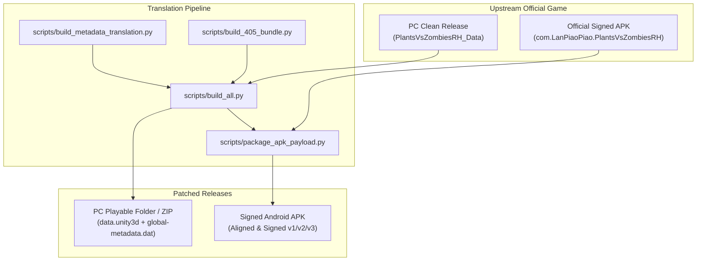

# PvZ Fusion Translation Toolkit — Architecture & Developer Guide

This document describes the technical architecture, repository structure, and build pipeline for the *Plants vs. Zombies: Fusion* translation toolkit (PC & Android).

---

## 1. Quick Start & Build Commands

### Prerequisites
- **Python 3.10+**
- Python packages: `pip install -r requirements.txt` (includes `UnityPy`, `Pillow`)
- **Java JDK 17+** with `apksigner` and `zipalign` (in PATH or Android SDK `build-tools`) for Android APK signing.

### Build Commands
```powershell
# 1. Build PC Version Only (Immediate Windows Testing)
python scripts/build_pc.py

# 2. Build Dual Release (PC Game + Signed Android APK)
python scripts/build_all.py
```

### Outputs
- **PC Executable**: `build/PC_PVZ-Fusion-4.0.5/PlantsVsZombiesRH.exe` (runnable immediately on Windows).
- **PC Release Artifacts**: `build/pc-405/` (`data.unity3d`, `global-metadata.dat`, build reports).
- **Android Signed APK**: `build/android-405/PvZ-Fusion-4.0.5-English-Android.apk` (aligned and signed with v1, v2, and v3 schemes).

---

## 2. Repository Structure

All translation data is strictly separated from build scripts:

```text
├── translation-data/
│   ├── Strings/
│   │   ├── translation_strings.json   # Exact UI strings & C# literals
│   │   ├── translation_regexs.json    # 1-based regex substitution rules
│   │   ├── customlevel_strings.json   # Custom level strings
│   │   └── abyss_buffs.json           # Realm / Abyss modifier strings
│   ├── Almanac/
│   │   ├── LawnStringsTranslate.json       # 720 Plants database
│   │   ├── ZombieStringsTranslate.json     # 235 Zombies database
│   │   ├── DetailStringsTranslate.json     # 47 Mechanics database
│   │   └── LevelCreatorHelpTranslate.json  # 11 Level Editor tutorial topics
│   └── Dumps/
│       ├── LawnStrings.json           # Raw official plant dump
│       ├── ZombieStrings.json         # Raw official zombie dump
│       ├── DetailStrings.json         # Raw official mechanics dump
│       └── LevelCreatorHelp.json      # Raw official help guide dump
├── scripts/
│   ├── build_pc.py                    # Dedicated PC build script
│   ├── build_all.py                   # Dual PC + Android build script
│   ├── build_metadata_translation.py  # Deterministic IL2CPP metadata builder
│   ├── build_405_bundle.py            # Unified Unity data.unity3d patcher
│   └── package_apk_payload.py         # Surgical APK payload replacer
├── docs/
│   ├── release-notes/                 # Historical and current release notes
│   │   ├── RELEASE-4.0.5-EN.md        # v4.0.5 dual release notes
│   │   ├── RELEASE-3.9-EN.md          # v3.9 legacy release notes
│   │   └── RELEASE-3.8.1-EN.md        # v3.8.1 legacy release notes
│   ├── ARCHITECTURE.md                # This architecture and dev guide
│   ├── RESEARCH-4.0.5.md              # In-depth 4.0.5 engine & binary research
│   ├── CLAUDE.md                      # AI agent maintainer handoff guide
│   ├── WORKFLOW.md                    # Step-by-step translation maintenance
│   ├── RELEASE-SAFETY.md              # APK safety & hash verification
│   ├── RELEASE_TEMPLATE.md            # GitHub release description template
│   └── TRANSLATION-MAINTENANCE.md     # Upstream synchronization rules
├── build/                             # Generated releases and game folders (git-ignored)
└── README.md
```

---

## 3. Translation Scope & Engine Data (v4.0.5)

The v4.0.5 translation pipeline targets:

- **Almanac Databases**:
  - **720 Plants** (`LawnStrings`): Fully translated names, descriptions, costs, and cooldowns.
  - **235 Zombies** (`ZombieStrings`): Complete enemy stats, abilities, and lore.
  - **47 Mechanics** (`DetailStrings`): Plant systems, zombie shields, environmental rules, and game modes.
  - **27 Evolution Routes** (`PlantEvolutionData`): Translated Pantheon evolution trees.
  - **74 Tactical Index Entries** (`ShootingAlmanacIndex`): Modifiers, conditions, and buff overrides.
- **Custom Level Creator & Event Rule Tools**:
  - **11 Tutorial Chapters** (`LevelCreatorHelp`): Comprehensive English beginner and advanced guide.
  - **Dynamic Editor UI**: Graph Check dialogs, List Initial Value modals, Node Description panels, element type selectors (`Integer`, `Float`, `Boolean`, `String`, `List`, `Object`, etc.), and undo/redo state banners.
- **Serialized UI & MonoBehaviours**:
  - Over **1,900 UI elements** translated in-place (TextMesh Pro at byte offset 88, `UnityEngine.UI.Text` at byte offset 144).
  - Runtime navigation backing fields (`Back to Menu`, `Previous Page`, `Next Page`, `Back to Index`).
- **Typography & Layout Optimization**:
  - **PC**: All `<size>` tags stripped to eliminate oversized/clipped text on desktop resolutions.
  - **Android**: Retains calibrated mobile sizing for optimal readability on handheld displays.
  - **Regex Rules**: Strict 1-based index templating (`{1}`, `{2}`) ensuring stable variable interpolation.
- **Localized Textures**:
  - Wave start banners (`StartPlant`, `StartReady`, `StartSet`, `HugeWave`, `FinalWave`).
  - Comic action particles (`Doom`, `Pow`, `Dong`, `guang`, `Sproing`, `SunExplosionPowie`, etc.).

---

## 4. Technical Architecture: Two-Payload Strategy

The translation operates with zero decompilation and zero binary modification:



### Modifying Only Two Payloads:
1. `data.unity3d` (Unity asset bundle containing serialized text, textures, fonts, and TextAssets).
2. `global-metadata.dat` (IL2CPP string literal pool; compiled safely with deterministic string table indexing).

All other game files remain completely official:
- Manifest (`AndroidManifest.xml`)
- DEX bytecode (`classes.dex`)
- Native binaries (`lib/arm64-v8a/libil2cpp.so`, `libunity.so`)
- Audio banks and runtime resources.
